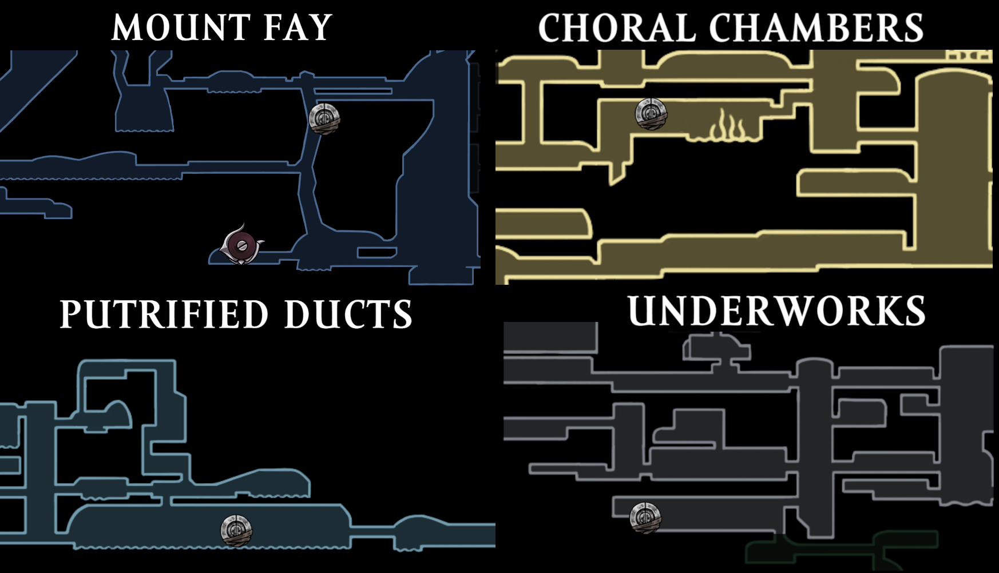

# Crest of the Weaver
- This crest is fully custom and themed around the Weavers and the use of silk.
- This mod has been in the works for over a year, and has been designed to be a template for other custom crests.
- **The crest is unlocked by binding a weaver in mt fay, in the lore tablet room, or via config.** (chapel not done yet, but this is the room that will be reworked) [This room actually was reworked/shrunk in 2022, as it was the original shaman/weaver crest chapel.]
- There is a manual unlock option in modmenu options, which also houses several gameplay changing features.
- Languages available In game for all existing Silksong options (some MTL, some manual)
- **1.1.2 changed the hold bind setting, if you installed previous versions you will need to manually change the config for this update to take effect properly**

## Installation and Compatibility
- This mod requires I18n, Needleforge, Unity Helper, fsm util, AssetHelper, and modmenu.
- This mod is safe to install and uninstall from an existing save.
- When uninstalled and then reinstalled, the save the data regarding the crests status  should remain intact. This includes weather its locked or unlocked, along with the  unlocked crest sockets and collected memory lockets.
- This mod has full compatability with Architect, and crest shuffler.

## Custom Mechanics
- There are 6 custom mechanics that are central to this mod.
- First, there is the introduction of half silk notches. These are akin to moss berry bands and cannot be used for healing or silk skills. (It has been made to work, with all types of silk degradation along with the Needolin, and silkspeed anklets.)
- Second, the use of silk in every attack, always draining half a silk.
- Third, silk gained from an attack is doubled, but due to the draining effect of attacks, a successful hit will provide 1.5 silk.
- Fourth, when you run out of silk, the hornet will break a mask to gain 3 silk. (lifeblood masks trade for 1)
- Fifth, a silk refund system, refunding silk on essential activities required for progression/transversal, along with enemy parries.
- Sixth, the crest gives you a half silk heart. Its disabled once you get your first true silkheart.

## Hud & Crest Icon
- The HUD and save icons are fully custom, and has both steel soul and normal varients.
- The HUD changes, to demonstrate weather or not the player has any silk.
- The crest inventory has 7 slots, 2 silk slots, 1 red slot, 2 blue slots, and 2 yellow slots.
- All yellow and blue slots are locked, and 4 memory lockets are added across the map.

## Map changes
- The crest can be found in a corpse in Mount Fay.
- The memory lockets are in Mt. Fay, Citadel Spa, Putrefied Ducts, and Wisp/Underworks connection.
- A new enemy has been added to a few spots across the map.
- **The chapel itself isnt done, but it is planned**

## Moveset
- Every attack always uses some silk.
- The default slashes have a shorter range than the wanderer's but are slightly faster than hunter's.
- The up slash is an overhead kick that is slower than the rest of the attacks.
- The down slash is a downward frontal kick, kinda like architect and hunter.
- The charge attack has both a windup and a long-range swipe (with 2 separate hitboxes)
- The dash attack has 2 variants. A 2-slash variant and a 4-slash variant. (4 slash uses 1 silk)
- Custom Wall slash animation.

## Binding
- The crest has a custom bind, with 2 config options depending on preference.
- To compensate for the increased silk generation, bind overall has been nerfed.
- The bind now acts like multibinder, but activates 3 times, which each heals a single mask.
- It requires the player hold down the bind key, and if let go will only heal the masks held down for. (All 9 silks are used even if you heal 1 mask.)
- The full duration is roughly 1.7x the length of a normal bind.
- There is a config option to disable the holding mechanic and make it a single long triple bind always.

## Tool interactions
- Multibinder adds a 4th bind that heals 1 mask.
- Injector band works as intended.
- Clawmirror damage was reworked to account for multiple binds, dealing 36 per instead of 67 each (with 20% less range)
- Weighted belt, flint slate, and long claw are all functional.
- Mossberry rings from druid eye/eyes can merge with half silk.
- Silkspeed Anklets works with half silk.
- The Wispfire lantern now uses half silk instead.

## Config Options
- Essential Refunds. (Entire refund system) **On by Default**
- Hold Bind option. (ability to cancel mid-bind) **Off by Default**
- Slow down charge attack's falling/airstall speed. **Off by Default**
- Force unlock config option **manual press**
- Silk Bind slot. (For when you get a silk skill) **Top slot by Default**
- Swap red tool slot with a silk slot. **Off by Default**
- Half knockback option. (Like witch) **Off by Default**
- Wisp fire lantern half silk cost **Off by Default**

## AI Disclosure
- AI was used in the process of developing this mod.
- I used it as an assistant to help with feedback and optimization and fix some bugs I couldn't figure out.
- Nearly all of the code that was ever generated with AI has long since been rewritten.
- It was primarily used to help me understand how to code areas I was initial unsure how to do myself.
- Like the sound implementation, and some experimental implementations during testing.
- It was also used to figure out and explain certain aspects of Silksong's own code, which were either tedious or I was unable to figure out. (Some FSMs and files in Assembly-CSharp.dll)
- Assets were commissioned and were not created with AI to the best of my knowledge.

## Credits
- Mebi (the artist who made the HUD, the Crest icon/design, and the half silk spools) https://ko-fi.com/mebi0910/gallery
- KAdala (the artist who made the entire moveset and all the other custom sprites) https://ko-fi.com/kadala_ka/shop
- Lobo (the artist who made the mod icon, full resolution of both variants included in the mod files) https://x.com/acheofslowdecay
- Redfrog (who coded the half silk)
- General Beria (who made the attack sounds)
- Last but most importantly, Team Cherry, for creating Silksong.

## Special Thanks to
- VoidBaroness (The Creator of Needleforge)
- Kaycodes13 (Creator of the Queencrest the initial template for this mod.)
- DerVorce (creator of the Void crest, which served as reference)
- Everyone in the HK wiki Discord, who uncovered the cut content that inspired this mod.
- Everyone in the HK modding Discord who helped refine my ideas and participated in the playtest.
- Everyone in the Silksoul Discord who has given me feedback and participated in the playtest.

## Please report any bugs or compatibility requests on github. (or ping me on discord)
## If anyone wants to take or reuse any of these ideas, feel free to.

# If this mod ever reaches the notice of Team Cherry, feel free to implement any of these ideas.
